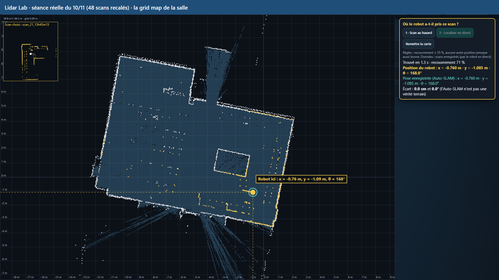
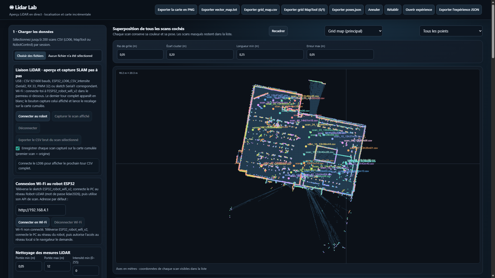
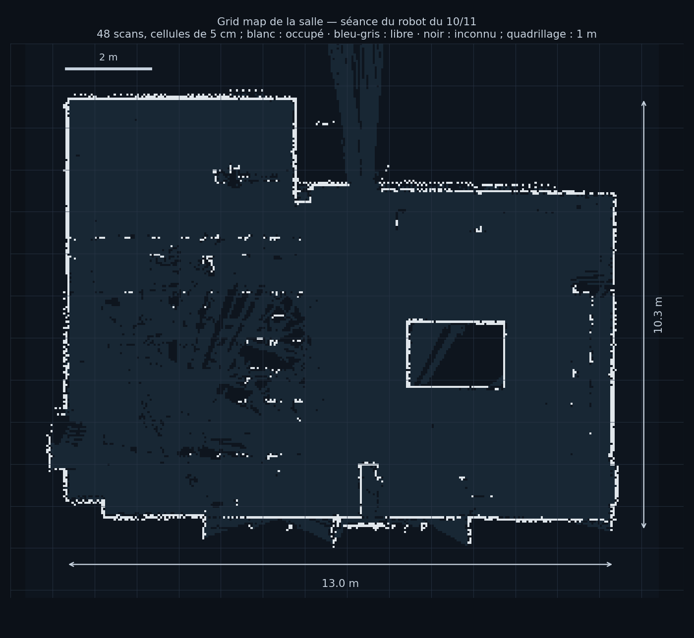
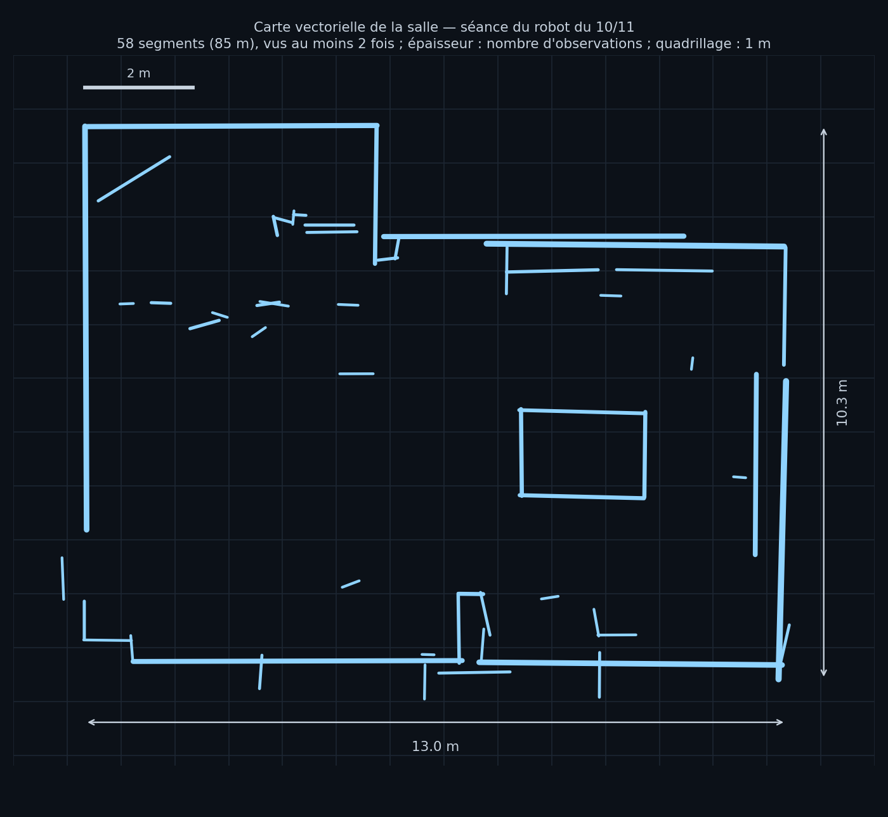

# Lidar Lab — cartographie et localisation en direct avec un robot et un lidar LD06

Application web et serveur Node.js pour piloter un robot équipé d'un lidar LD06, construire la carte de la
salle pendant le trajet (**Auto-SLAM**), localiser un scan sur la carte, assembler des séances enregistrées
et faire explorer la salle au robot. Projet réalisé dans le cadre du module « Cartographie et
localisation appliquée à la robotique mobile ».

C'est l'**outil 2** du projet ; l'outil 1 (bibliothèque Python *carto*, Lidar Plot et banc d'évaluation)
est dans un dépôt séparé. Les deux outils lisent et écrivent les mêmes fichiers.



## Fonctionnalités

- **Robot** : pilotage depuis le PC (boutons, clavier) ou le téléphone, rotations de 15° et 45°, STOP
  prioritaire ; liaison Wi-Fi avec l'ESP32 (sketch de référence `ESP32_robot_wifi_v5`, dépôt de l'outil 1).
- **Auto-SLAM** : à chaque arrêt, un scan est capturé, localisé sur la grid map déjà construite et ajouté
  s'il est fiable ; sinon il est mis en attente et réessayé quand la carte a grandi.
- **Cartes** : grid map (cellules de 5 cm, log-odds), carte vectorielle, couche de points ; exports CSV,
  format MapTool, poses JSON, image PNG.
- **Localisation** : recherche globale sur toute la carte et sur 360°, refus des poses douteuses
  (recouvrement insuffisant, ambiguïté sur le recouvrement, contradiction avec l'espace libre).
- **Assemblage hors ligne** : bouton « Localiser et construire la carte » pour une séance enregistrée.
- **Démonstration** : panneau « Où le robot a-t-il pris ce scan ? ».
- **Exploration automatique** : le robot va seul vers la zone inconnue la plus proche, par petits pas
  contrôlés à l'arrêt.
- **Séances** : chaque relevé est enregistré sur le disque (scans, poses, grid map) et peut être repris.



## Démarrage rapide

```bash
node --test tests/*.test.js                                  # 64 tests (Node.js 20 ou plus récent)
node serveur_robot/serveur.js --dossier <dossier_des_seances>   # puis ouvrir http://localhost:8000
```

Sans robot : ouvrir `index.html` dans Chrome ou Edge et charger des scans CSV (par exemple ceux du dossier
`data/` de l'outil 1). Avec le robot : téléverser `ESP32_robot_wifi_v5`, connecter le PC au même réseau,
lancer le serveur ; il trouve le robot tout seul. Le téléphone s'utilise sur `/telephone`.

## Architecture

```
ESP32 + LD06  <-- HTTP / Wi-Fi -->  serveur_robot/serveur.js  <-->  navigateur : index.html + lidar_core.js
 /scan /drive /turn /stop            séances sur disque, Auto-SLAM,      interface, couches, localisation,
                                     exploration.js                      pilote_lidar_lab.js, demo_localisation.js
                                            ^
                                            +-- téléphone : serveur_robot/telephone.html (même séance)
```

| Fichier | Rôle |
|---|---|
| `lidar_core.js` | Cœur de calcul, sans dépendance au navigateur : lecture des CSV, filtres, grid map, `locateScanOnGrid`, choix du candidat, assemblage d'une séance |
| `index.html` | Interface : chargement, couches, localisation, comparaisons, exports |
| `serveur_robot/serveur.js` | Relais vers le robot, séances, Auto-SLAM, routes de l'exploration |
| `serveur_robot/pilote_lidar_lab.js` | Panneau de pilotage dans l'interface |
| `serveur_robot/exploration.js` | Exploration par frontières (chemin sur la grille, contrôle à l'arrêt, demi-tour) |
| `serveur_robot/telephone.html` | Version téléphone |
| `demo_localisation.js` | Démo de localisation d'un scan tiré au hasard |
| `tests/` | Tests : capture USB (faux port série), serveur, assemblage hors ligne, corpus de faux positifs, exploration sur robot simulé |
| `docs/validation/` | Protocoles et rapports de validation de la localisation |
| `prototypes/version_2/` | Prototype de la version suivante de l'interface (en cours) |
| `anciennes_versions/` | Versions précédentes des fichiers modifiés |

## Résultats

| Expérience | Résultat |
|---|---|
| Séance réelle du 10/11 (49 scans) | 48 scans recalés par l'Auto-SLAM ; carte complète de la salle (environ 13 × 10 m) |
| Localisation d'un scan sans position de départ (48 scans réels) | 42 retrouvés, 0 fausse position, écart médian 2,5 cm avec l'Auto-SLAM |
| Fausses poses de l'assemblage (600 scans simulés jamais utilisés pour le réglage) | 255 → 48 → 2 avec les règles d'ambiguïté et d'espace libre |
| Exploration sur robot simulé (salle jamais vue) | 0 collision, 95 à 96 % de la salle cartographiée |





## Documentation

- [Guide d'utilisation détaillé](docs/GUIDE_UTILISATION.md) : formats de scans acceptés, liaison USB et
  Wi-Fi, pilotage, Auto-SLAM, téléphone.
- [Validation](docs/validation/) : protocoles, critères fixés avant les mesures, résultats.

## Formats

Scans : `angle_deg,distance_mm,intensity` (projet LD06), `angle_deg,distance_m,intensity` (RobotControl),
`angle_deg,r_m,x_rel_m,y_rel_m` (MapTool), nuage cartésien `x_m,y_m`. Poses : JSON
`{"scan": [x_m, y_m, theta_deg]}`. Grid map : CSV du projet ou format MapTool.
